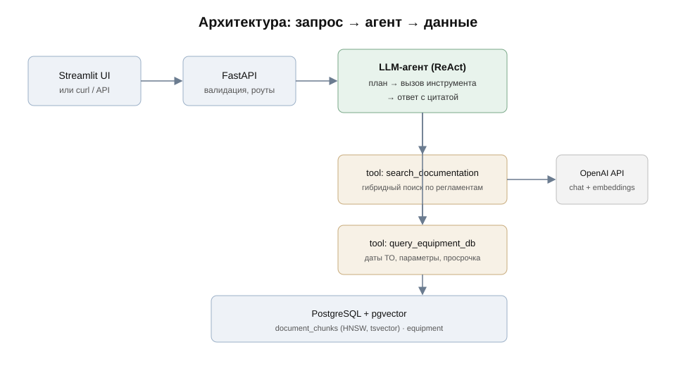

# ИСППР по обслуживанию оборудования

[](https://github.com/Xalegor1/equipment-maintenance-rag-agent/actions/workflows/ci.yml)


Система поддержки принятия решений для обслуживания промышленного оборудования.
Отвечает на вопросы вида «что делать с этим трансформатором, если ТО просрочено» —
по регламентам, с датами из базы и со ссылкой на пункт документа.

Агент не просто ищет по PDF. Он **вызывает инструмент с базой оборудования**:
получает конкретную единицу, даты осмотров, состояние, считает просрочку — и только
на этих данных строит ответ. Если ответа в документах нет, он так и говорит.

## Задачи, которые закрывает

| Кто | Что получает |
|---|---|
| Обходчик / ремонтник | Что проверить и в каком порядке по конкретной единице, со ссылкой на норматив |
| Диспетчер | Сводка по просроченным ТО без ручного листания регламентов |
| Новый сотрудник | Быстрый вход в тему: ответы с цитатами вместо чтения 300 страниц |
| Инженер | Проверяемая атрибуция — каждый ответ можно открыть и сверить |

## Пример

```
Вопрос: Трансформатор ПК-630/10-2 давно не обслуживался — что делать?

Ответ агента:
  Последний осмотр 14.08.2024, просрочка ~21 месяц, состояние «в эксплуатации».
  1. Вывести из работы и выполнить ... (РД 34.45-51.300-97, с. 12)
  2. Проверить ... (Правила технической эксплуатации, с. 34)
  Источники: РД 34.45-51.300-97 с. 12; Правила ТЭ, с. 34.
```

## Как это работает



1. Запрос приходит в API или UI.
2. Агент на LangChain ReAct решает, что нужно: документация, база или оба источника.
3. `search_documentation` делает гибридный поиск (dense по pgvector + полнотекстовый
   по русской конфигурации PostgreSQL) и возвращает фрагменты с номерами страниц.
4. `query_equipment_db` достаёт карточку единицы и считает просрочку.
5. Ответ собирается только из полученных данных, с дословной цитатой и ссылкой.

Подробности — [docs/architecture.md](docs/architecture.md).

## Возможности

- Гибридный retrieval: pgvector (HNSW) + FTS, объединение результатов с порогом.
- Tool-calling с проверкой существования единицы и расчётом дат.
- Загрузка корпуса через UI и `POST /api/v1/ingest`, список документов — `GET /documents`.
- Дословная атрибуция: файл, страница, цитата.
- Оценка качества по RAGAS, эксперименты по размеру чанка (256/512/1024).
- 60 тестов, ruff и mypy в CI; стек поднимается одной командой.

## Стек

| Слой | Технологии |
|---|---|
| Агент | LangChain ReAct (AgentExecutor), gpt-4o-mini |
| Эмбеддинги | text-embedding-3-small (1536) |
| Хранение | PostgreSQL + pgvector (HNSW), таблица equipment |
| API | FastAPI + Uvicorn |
| UI | Streamlit |
| Оценка | RAGAS |
| Инфраструктура | Docker Compose, Makefile, GitHub Actions |

## Запуск

```bash
cp .env.example .env
# OPENAI_API_KEY + сменить POSTGRES_PASSWORD

docker compose up --build
# API:      http://localhost:8000/docs
# UI:       http://localhost:8501
```

Postgres при первом старте создаёт схему и наполняет `equipment` демо-данными.
Сброс: `docker compose down -v && docker compose up --build`.

Без Docker: `docker compose up -d postgres`, затем `pip install -e ".[dev]"`,
`make dev` и `make frontend`. Нужен PostgreSQL с pgvector.

## API

```bash
# карточка единицы и расчёт просрочки
curl http://localhost:8000/api/v1/equipment/ПК-630/10-2

# вопрос агенту
curl -X POST http://localhost:8000/api/v1/agent \
  -H "Content-Type: application/json" \
  -d '{"question":"Трансформатор ПК-630/10-2 давно не обслуживался — что делать?"}'

# только RAG, без агента
curl -X POST http://localhost:8000/api/v1/query \
  -H "Content-Type: application/json" \
  -d '{"question":"Порядок подготовки трансформатора к ремонту"}'
```

## Данные

Демо-корпус в `data/docs/`: РД 34.45-51.300-97 и «Правила технической эксплуатации
электроустановок потребителей». Свой корпус загружается любыми PDF через UI или API;
схема БД не привязана к конкретным документам.

## Качество

```bash
make test   # 60 тестов
make lint   # ruff + mypy
```

RAGAS-прогон: `python -m src.eval.run_eval --config configs/eval_experiment_v2.yaml --ingest-docs data/docs/`

> Тестсет `data/eval/testset.json` пока собран на трёх статьях по ML, а не на
> регламентах — для доменной оценки пересоберите его: `make generate-testset`.
> Это честная известная дыра, а не «всё зелёное».

## Структура

```
src/agent   инструменты, промпт, AgentExecutor, сервис
src/db      пул соединений, репозиторий оборудования
src/rag     loader, chunker, embedder, vector_store, retriever, generator
src/api     роуты, схемы, зависимости
src/eval    RAGAS и генератор тестсета
frontend/   Streamlit · docker/init.sql · configs/ · tests/ · docs/
```

## Ограничения

- Прототип: демо-база синтетическая, для промышленного внедрения нужны интеграции
  с ТОиР-системой, роли и аудит.
- Нужен ключ OpenAI, локальные модели не поддерживаются.
- Промпт-гардрейлы эвристические.
- Поиск настроен под русский язык.

## Лицензия

MIT — [LICENSE](LICENSE). Автор: Егор Еловенко · [GitHub](https://github.com/Xalegor1)
